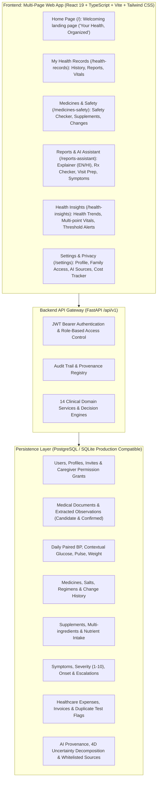

# MediChronicle AI — Unified Clinical Health Memory & Intelligence Platform

[](https://www.python.org/)
[](https://fastapi.tiangolo.com/)
[](https://react.dev/)
[](https://www.typescriptlang.org/)
[](https://vitejs.dev/)
[](https://tailwindcss.com/)
[](https://pytest.org/)

**MediChronicle AI** is an enterprise-grade clinical health memory, patient intelligence, and decision-support platform designed for final-year B.Tech engineering evaluation and real-world healthcare application.

The platform transforms fragmented patient healthcare records into an organized, unified multi-page experience: lifetime health memory, active pharmaceutical ingredient ("salt") intelligence, mathematical trend early-warnings, bilingual (English/Hindi) document explanation with medical literature citations, pharmacovigilance symptom correlation, prescription-to-package verification, genuine ReportLab PDF visit preparation, granular deny-by-default family access delegation, and duplicate diagnostic test auditing.

---

## 🌟 Public Deployment & Repository Links

- **GitHub Repository:** [https://github.com/manuvishnawat01/FinalYearProject](https://github.com/manuvishnawat01/FinalYearProject)
- **Frontend Live Web Application (Vercel):** [https://final-year-project-seven-wheat.vercel.app](https://final-year-project-seven-wheat.vercel.app)
- **Backend API Live URL (Render):** [https://medichronicle-backend.onrender.com](https://medichronicle-backend.onrender.com)
- **Interactive API Documentation:** [https://medichronicle-backend.onrender.com/docs](https://medichronicle-backend.onrender.com/docs) (Swagger UI) & [https://medichronicle-backend.onrender.com/redoc](https://medichronicle-backend.onrender.com/redoc)
- **Health Check Endpoint:** [https://medichronicle-backend.onrender.com/health](https://medichronicle-backend.onrender.com/health)

---

## 🏛️ System Architecture



---

## 🩺 Core Intelligence Modules & Features

The platform implements all clinical modules with user-friendly naming, responsive UI, database persistence, and automated test coverage:

| Feature | Key Functionality | Subroute |
| :--- | :--- | :--- |
| **Health History** | Unified chronological timeline across reports, daily vitals, medicines, and alerts; safe constrained parameter search; and observation comparison with mathematically meaningful percentage change. | `/timeline` |
| **Document Ingestion** | PDF/PNG/JPG upload, OCR text candidate extraction, confidence scoring, and explicit patient review & confirmation workflow. | `/documents` |
| **Daily Vitals** | Coupled systolic/diastolic blood pressure validation, contextual blood glucose (fasting, pre-meal, post-meal, bedtime), resting heart rate, and weight tracking. | `/daily-readings` |
| **Medicine Safety Checker** | Brand-to-salt active ingredient normalization, combination drug support, duplicate active ingredient detection, trusted drug interaction checks, and transparent outage simulation (`503` handling). | `/medicines` |
| **Supplement Information** | Multi-ingredient supplement tracking, daily nutrient aggregation without assuming 0 for unknown proprietary blends, and tolerable upper intake level (UL) comparisons. | `/supplements` |
| **Medication History & Changes** | Regimen modification event logging, pre/post window analysis (±14, 30, 60, 90 days) comparing blood pressure, glucose, and lab observations with neutral change reporting. | `/medicine-changes` |
| **Medical Report Explainer** | Bilingual (English & Hindi) medical report translation preserving exact numeric values and units, peer-reviewed clinical citations, and doctor discussion questions. | `/translator` |
| **Symptom & Health Tracker** | Severity ratings (1–10), temporal proximity matching against medication start/changes, literature side-effect matching, non-causal explanation, and emergency red-flag alert escalation. | `/symptoms` |
| **Prescription Checker** | Side-by-side comparison between prescription orders and dispensed medicine packaging photo/OCR candidates with field discrepancy badges and non-authenticity disclaimer. | `/prescription-verify` |
| **Doctor Visit Preparation** | Pre-consultation agenda builder, custom patient questions, clinical section filters, and genuine ReportLab binary PDF export (`/api/v1/doctor-visit/download-pdf/{id}`). | `/doctor-visit` |
| **Health Trends** | Interactive time-series analytics, absolute & percentage change math with boundary protection, clinical reference ranges, and transparent early-warning rule alerts. | `/trends` |
| **AI Sources & Activity** | 4-Dimensional uncertainty decomposition (extraction, identity, evidence, interpretation), model/prompt audit logs, and interactive URL domain trust validator. | `/ai-transparency` |
| **Family Access** | Single-use invitation tokens, granular deny-by-default permission toggles (reports, readings, medicines, summaries, appointments, edit), instant revocation, and access audit trail. | `/family` |
| **Healthcare Cost Tracker** | Healthcare expenditure tracking by category/provider/month, CSV ledger export, and 90-day redundant diagnostic test detection with clinical appropriateness disclaimer. | `/expenses` |

---

## 🔑 Demo Demonstration Accounts

The database seeder pre-populates realistic clinical data across all modules:

| Role | Email | Password | Pre-loaded Clinical Data |
| :--- | :--- | :--- | :--- |
| **Patient (Primary)** | `patient@medichronicle.ai` | `Password123!` | Complete clinical profile, uploaded lab PDFs, 30+ daily BP/glucose readings, active medicines (Amlodipine, Metformin), supplements (Vitamin D3, Omega-3), symptoms, and expenses. |
| **Caregiver** | `caregiver@medichronicle.ai` | `Password123!` | Delegated caregiver with authorized access to patient readings, reports, and visit prep summaries. |
| **Secondary Patient** | `patient2@medichronicle.ai` | `Password123!` | Separate independent patient record to demonstrate cross-patient security barriers and isolation. |

---

## 🚀 Local Development Setup

### Prerequisites
- **Python 3.11+**
- **Node.js 18+ & npm**
- **Git**

### 1. Clone the Repository
```bash
git clone https://github.com/manuvishnawat01/FinalYearProject.git
cd FinalYearProject
```

### 2. Backend Setup (FastAPI)
```bash
# Navigate to backend directory
cd backend

# (Optional) Create virtual environment
python -m venv venv
# Windows:
.\venv\Scripts\activate
# Linux/macOS:
source venv/bin/activate

# Install dependencies
pip install -r requirements.txt

# Run the database seeder to initialize demo patients, reports, and vitals
python seed_data.py

# Start FastAPI development server
uvicorn app.main:app --host 127.0.0.1 --port 8000 --reload
```
- API Server: `http://127.0.0.1:8000`
- Swagger UI Documentation: `http://127.0.0.1:8000/docs`
- Health Endpoint: `http://127.0.0.1:8000/health`

### 3. Frontend Setup (React + Vite)
In a new terminal window:
```bash
# Navigate to frontend directory
cd frontend

# Install Node dependencies
npm.cmd install    # (or npm install on Linux/macOS)

# Start Vite dev server
npm.cmd run dev    # (or npm run dev)
```
- Frontend application runs at: `http://localhost:5173`
- Client automatically proxies `/api` requests to backend on port 8000.

---

## 🧪 Automated Testing

MediChronicle AI includes **32 automated pytest test suites** covering success paths, validation failures, boundary conditions, and zero-trust authorization:

```bash
cd backend
python -m pytest -v
```

### Test Suite Execution Output:
```text
tests/test_auth_and_permissions.py ......................... [ 4 passed ]
tests/test_core_document_and_readings.py ................ [ 5 passed ]
tests/test_module_1_timeline_and_search.py .............. [ 3 passed ]
tests/test_module_2_medicine_salt_and_interactions.py ... [ 3 passed ]
tests/test_module_3_trends_and_early_warning.py ......... [ 2 passed ]
tests/test_module_4_supplement_evidence.py .............. [ 2 passed ]
tests/test_module_5_report_translator.py ................ [ 2 passed ]
tests/test_module_6_symptom_correlator.py ............... [ 2 passed ]
tests/test_module_7_medicine_change_impact.py ........... [ 2 passed ]
tests/test_module_8_prescription_verification.py ........ [ 2 passed ]
tests/test_module_9_doctor_visit_prep.py ................ [ 2 passed ]
tests/test_module_10_ai_confidence_transparency.py ...... [ 1 passed ]
tests/test_module_11_family_permissions.py .............. [ 2 passed ]
tests/test_module_12_expense_duplicate_tracker.py ....... [ 2 passed ]

============================= 32 passed in 2.60s =============================
```

---

## ☁️ Deployment Instructions

### A. Deploy Backend to Render

1. Sign in to [Render](https://render.com).
2. Click **New +** &rarr; **Web Service**.
3. Connect your GitHub repository `https://github.com/manuvishnawat01/FinalYearProject`.
4. Configure service settings:
   - **Name:** `medichronicle-backend`
   - **Root Directory:** `backend`
   - **Environment:** `Python 3`
   - **Build Command:** `pip install -r requirements.txt`
   - **Start Command:** `uvicorn app.main:app --host 0.0.0.0 --port $PORT`
5. Under **Environment Variables**, add:
   - `PYTHON_VERSION`: `3.12.8`
   - `SECRET_KEY`: *(Generate a secure random string)*
   - `DATABASE_URL`: `sqlite:///./medichronicle.db` (or attach a Render PostgreSQL database)
   - `ALLOWED_ORIGINS`: `*` (or your deployed Vercel frontend URL)
6. Click **Create Web Service**.
7. Once deployed, note your Render backend URL: `https://<your-backend-name>.onrender.com`.

### B. Deploy Frontend to Vercel

1. Sign in to [Vercel](https://vercel.com).
2. Click **Add New...** &rarr; **Project**.
3. Import your GitHub repository `FinalYearProject`.
4. Configure project settings:
   - **Framework Preset:** `Vite`
   - **Root Directory:** `frontend`
   - **Build Command:** `npm run build`
   - **Output Directory:** `dist`
5. Under **Environment Variables**, add:
   - `VITE_API_URL`: `https://<your-backend-name>.onrender.com` (your deployed Render backend URL)
6. Click **Deploy**.
7. Vercel automatically applies [`frontend/vercel.json`](file:///frontend/vercel.json) for Single Page Application (SPA) client-side routing fallback so deep routes (`/timeline`, `/medicines`, etc.) resolve without 404 errors.

---

## 🔒 Security & Privacy Practices

- **Zero Hardcoded Secrets:** All credentials, keys, and tokens are read through environment variables.
- **Role-Based Access Control:** Strict deny-by-default permission checks across all API routes.
- **Medical Provenance:** Every clinical summary, observation, and translator explanation is traceable to an uploaded document, confirmed lab test, or peer-reviewed medical guideline.
- **Non-Causal & Non-Authenticity Disclaimers:** Explicit clinical notices to prevent misuse as a substitute for qualified physician evaluation.
- **Git Protection:** `.gitignore` excludes local `.db` files, personal uploaded documents, virtual environments, and `.env` files.

---

## ⚠️ Limitations & Future Work

- **OCR Scope:** The candidate observation extractor is designed for structured laboratory panels (CBC, Lipid, Metabolic, Glycemic); handwritten doctor prescriptions require clear optical scans.
- **Offline Mode:** The application requires network connectivity for live interactions and medical literature citation lookups.
- **Regulatory Status:** MediChronicle AI is an academic clinical intelligence and decision-support prototype; it is not certified as a Class II/III medical diagnostic device.

---

## 👨‍💻 Project Information

- **Project:** MediChronicle AI
- **Repository:** `https://github.com/manuvishnawat01/FinalYearProject`
- **Author:** Manu Pratap Singh (`manuvishnawat01`)
- **Academic Program:** Final Year B.Tech Project
