# MediChronicle AI — Architecture & Domain Design Document

## 1. System Architecture Overview

MediChronicle AI follows an enterprise N-Tier decoupled architecture designed for high clinical safety, data integrity, auditability, and zero-trust data isolation.

```mermaid
flowchart TD
    Client["React 19 / TypeScript / Tailwind Frontend"]
    Gateway["FastAPI 0.115 Async REST Gateway (/api/v1)"]
    
    subgraph Security["Zero-Trust Security & RBAC Layer"]
        JWT["JWT Bearer Authentication"]
        PermEngine["Permission Engine (Deny-by-Default)"]
        AuditLogger["Security & Access Audit Trail"]
    end
    
    subgraph Services["Core Clinical & Intelligence Domain Services"]
        DocService["Document Ingestion & OCR Candidate Service"]
        ReadingService["Paired BP & Contextual Glucose Service"]
        TimelineService["Timeline & Constrained Search Service"]
        SaltService["Salt Intelligence & Interaction Engine"]
        TrendService["Mathematical Trends & Warning Engine"]
        SuppService["Supplement & Nutrient Aggregation Service"]
        TransService["Bilingual Report Translator & Citation Service"]
        SymptomService["Symptom & Temporal Pharmacovigilance Service"]
        ChangeService["Medicine Change Impact Tracker"]
        VerifyService["Prescription vs Package Verifier"]
        VisitService["Visit Prep & ReportLab PDF Generator"]
        AIService["AI Transparency & 4D Uncertainty Service"]
        FamilyService["Family Delegation & Permissions Service"]
        ExpenseService["Cost Ledger & 90-Day Duplicate Scanner"]
    end
    
    subgraph Storage["Persistent Relational Storage"]
        DB[(PostgreSQL / SQLite via SQLAlchemy Engine)]
        Filesystem["Local Secure Document & PDF Vault"]
    end

    Client -->|HTTP / JSON / Multi-part| Gateway
    Gateway --> Security
    Security --> Services
    Services --> Storage
```

---

## 2. Security & Zero-Trust RBAC Model

### 2.1 Role-Based Access Control
- **`patient`**: Complete sovereignty over personal medical history, vitals, prescriptions, and access grants.
- **`caregiver`**: Delegated proxy access strictly governed by granular, unbundled permission flags (`can_view_reports`, `can_view_readings`, `can_view_medicines`, `can_view_summaries`, `can_view_appointments`, `can_edit`). Every access check evaluates active status and revoked timestamps in real-time.
- **`clinician`**: Read-only oversight of authorized patients for clinical review and pre-consultation synthesis.
- **`admin`**: System-level maintenance and compliance auditing without direct patient health data tampering.

### 2.2 Deny-by-Default Enforcement
Any access attempt to a patient's record by another user defaults to denial (`HTTP 403 Forbidden`). Only an active, unexpired record in the `CaregiverPermission` table with the specific capability boolean enabled permits read or edit operations.

### 2.3 Comprehensive Audit Trail
Every read, permission mutation, delegation grant, and revocation is recorded in the `AuditLog` table with:
- `actor_user_id`
- `action` (e.g. `VIEW_DOCUMENT`, `GRANT_PERMISSION`, `REVOKE_PERMISSION`)
- `resource_type` and `resource_id`
- `ip_address`
- Exact timestamp

---

## 3. Clinical Data Model & Provenance Integrity

### 3.1 Provenance Hierarchy
All medical facts must be traceable to their origin:
1. **`patient_entered`**: Manually keyed vitals or symptoms.
2. **`device_provided`**: Digital monitor uploads.
3. **`extracted_unverified`**: OCR / document parser candidate extractions awaiting clinical or patient verification.
4. **`confirmed_by_user`**: Explicitly approved extractions promoted to active clinical observations.
5. **`clinician_recorded`**: Facts documented by treating doctors.
6. **`ai_generated`**: Algorithmic summaries, explanations, or suggestions. **AI summaries are never conflated with verified medical facts.**

### 3.2 4-Dimensional AI Uncertainty Decomposition
Every AI interpretation or translation decomposes uncertainty into four distinct axes:
- **`extraction_uncertainty`** ($0.0 - 1.0$): Degree of illegibility, OCR noise, or low-resolution scan artifacts.
- **`identity_uncertainty`** ($0.0 - 1.0$): Ambiguity in matching brand names to standardized active pharmaceutical ingredients.
- **`evidence_uncertainty`** ($0.0 - 1.0$): Quality and strength of scientific evidence (e.g. randomized controlled trials vs case series).
- **`interpretation_uncertainty`** ($0.0 - 1.0$): Degree of clinical nuance requiring personalized physician judgment.

---

## 4. Architectural Safeguards & Clinical Protections

1. **Non-Causal Explanation Enforcement:**
   Temporal correlation between starting a drug and developing a symptom explicitly clarifies that proximity does not constitute medical proof of causation.
2. **Emergency Red-Flag Escalation:**
   Symptoms matching emergency thresholds (e.g. chest pain, severe dyspnea, neurological deficit, or severity $\ge 8$) bypass standard queues and display prominent urgent-care advisories.
3. **External Provider Outage Isolation:**
   Drug interaction engines operate behind an abstraction interface. If an upstream drug database is offline or unreachable, the system displays `"Interaction check unavailable (HTTP 503)"`, never fabricating a false `"No interactions found"` result.
4. **Genuine Binary PDF Generation:**
   Doctor visit agendas are rendered via ReportLab directly to binary PDFs with structured headings, medication tables, vitals summaries, and patient questions.
